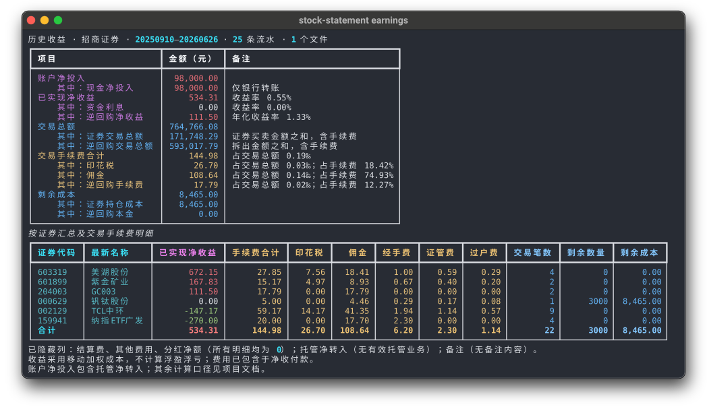

# stock-statement

把证券交割单变成收益报告和交易计划。支持招商证券、东方财富证券的 TXT 文件，可在本地网页查看，也可在终端生成报告。



- **看收益**：汇总股票、ETF、分红、手续费和逆回购，按券商独立核算，再合并展示。
- **复盘交易**：在日 K 上查看买卖记录、价格和未完成交易，切换两种策略观察后续计划。
- **看下一笔**：根据候选价格、交易数量与费率，查看卖出或回补价位。

## 本地网页


- **收益总览**：汇总各账户的收益、持仓、分红与费用，支持合并多份交割单。
- **交易复盘**：在日 K 图上查看买卖记录与未完成交易，支持缩放时间和价格范围。
- **交易计划**：切换 A/B 策略，结合候选价格、交易数量与费率查看卖出或回补价位。

交易数据保存在本地服务内存中，清空数据或关闭服务后释放。公共行情需要联网，行情不可用时仍可查看交割单报告。

## 网页使用

需要 Python 3.14+、[uv](https://docs.astral.sh/uv/) 和 [pnpm](https://pnpm.io/installation)（构建前端时需要 Node.js）。在项目目录运行：

```powershell
pnpm --dir frontend install --frozen-lockfile
pnpm --dir frontend build
uv run --extra ui stock-statement ui
```

1. 打开终端输出的本地地址，拖入交割单 TXT 文件。
2. 确认账户标签并开始分析。同一账户的分段文件使用相同标签，不同账户使用不同标签。
3. 查看收益总览，点击证券名称进入交易详情，按需切换 A/B 策略。

招商证券可同时上传“历史成交查询”TXT，补充成交时间。文件要求见[输入格式说明](docs/input-formats.md)。

安装 GitHub Release 提供的 Python wheel 后，运行 `stock-statement ui` 会自动下载并校验同版本前端资源，后续启动复用本地缓存，无需 Node.js 或 pnpm。安装方式、缓存位置和离线使用见[发布说明](docs/development.md#发布)。

## 终端报告

```powershell
# 单份交割单
uv run stock-statement earnings "data/招商证券.txt"

# 多份文件，或包含 TXT 的目录
uv run stock-statement earnings "data/第一段.txt" "data/第二段.txt"
uv run stock-statement earnings "./data"
```

终端模式不需要前端或 UI 可选依赖。支持 UTF-8 与 GB18030 编码，重叠导出的流水自动去重。

## 使用须知

提供完整交易流水，才能正确还原持仓与成本。报告中的历史收益采用移动加权成本；详情中的 A/B 是两种交易配对策略，结果不能相加。交易计划由交割单推演，不是券商实时持仓或下单指令。

- [输入格式、账户与成交时间补全](docs/input-formats.md)
- [收益计算与 A/B 策略口径](docs/calculation.md)
- [开发、构建与部署](docs/development.md)
- [模块、API 与行情缓存设计](docs/architecture.md)

截图使用 [pamburus/termframe](https://github.com/pamburus/termframe) 与 [btahir/shotcandy](https://shotcandy.app) 创建。
